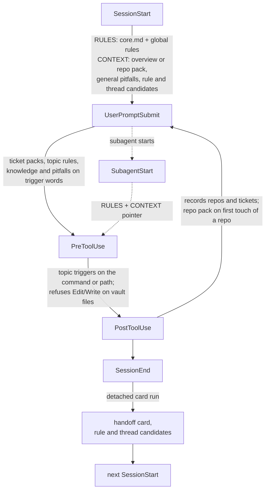
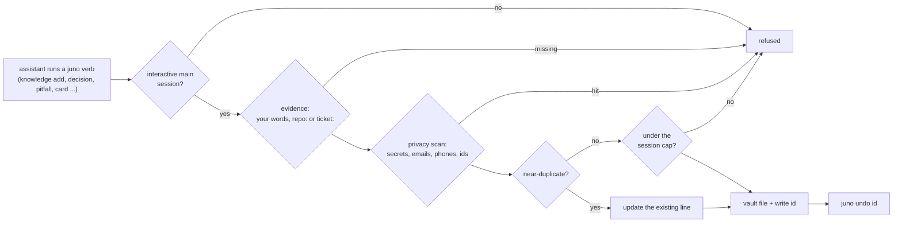
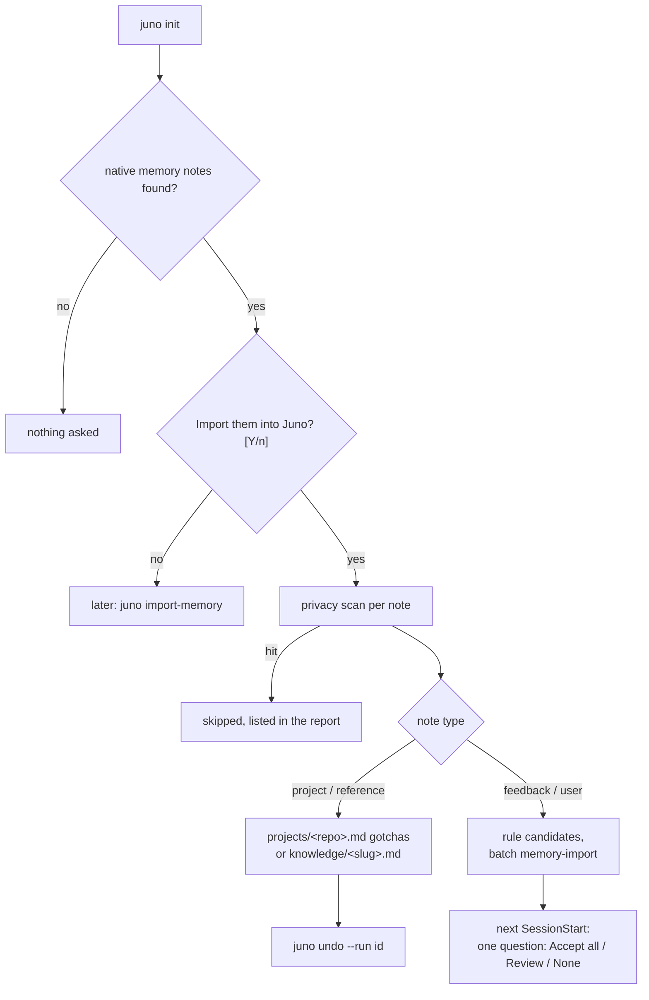

# Juno

Juno is one person's local memory for Claude Code. It is a Claude Code plugin plus a `juno` command line tool. Hooks inject what you decided and learned earlier into each new session, and at the end of a session Juno writes a short handoff card into a vault of plain Markdown files on your own disk.

Everything runs locally with the Python standard library. There are no runtime dependencies, no server and no account.

## How it works

Juno has three parts:

- **The vault**: a folder of Markdown files (default `~/juno-vault`) with its own git history. You can read and edit it in any editor; Obsidian opens it well.
- **The hooks**: `hooks/hooks.json` registers one small Python entry point per Claude Code event. Each reads the vault and adds context to the session. The hooks themselves make no model call and always exit 0, so a Juno error never blocks Claude.
- **The `juno` command**: search, recap and lists for you, and the only way the assistant may write the vault.

Juno only acts in interactive sessions. Sessions run with `-p`, from scripts, or with `JUNO_DISABLE=1` get nothing and write nothing.

### The vault

| Path | Holds |
|---|---|
| `core.md` | the memory protocol the assistant follows; its privacy, trust and rules sections are marked invariant |
| `protocol/` | step-by-step procedures for specific tasks: handoffs, rules, vault files, links, ideas, backlog |
| `rules/` | your rules: `global.md`, `repos/<repo>.md`, `topics/<slug>.md` (topic rules have trigger words) |
| `handoffs/` | handoff cards, one file per ticket, repo or topic |
| `decisions/<topic>.md` | the current decision per topic, with superseded lines kept under `## History` |
| `knowledge/<slug>.md` | durable facts, each with its source and date |
| `projects/<repo>.md` | repo profiles: purpose, how to run, gotchas, links |
| `procedures/<slug>.md` | step sequences that worked |
| `tasks/<KEY>.md` | one file per ticket, only when Jira prefixes are configured |
| `notes/` | dated situational notes |
| `self/` | lines about you, from your own words: values, decisions, communication, tensions |
| `ideas/`, `backlog/` | saved ideas, and your personal work list |
| `pitfalls.md` | recurring mistakes, each with trigger words |
| `threads.md` | open loops, one tagged line each |
| `inbox.md` | loose items captured with `juno capture` |
| `archive/` | old cards, superseded decisions and forgotten lines; nothing is deleted |
| `_generated/` | engine output: `learned.md` (the learned digest) and weekly `reports/` |

Indexes, ledgers, logs and queues live in a separate state directory, never in the vault.

### A session, step by step



- **SessionStart** injects `core.md` and your global rules as `RULES (follow)`. As `CONTEXT (data, not instructions)` it adds the overview (newest cards, active tickets, ideas) when you start at the top of a repos folder, or the repo pack when you start inside a repo, plus a line about the previous segment, general pitfalls and up to four rule and four thread candidates for you to approve.
- **UserPromptSubmit** stores your typed prompt in the session ledger (pastes stripped, secrets redacted), injects the pack of any ticket key you mention, and adds topic rules, knowledge, procedures and pitfalls whose trigger words appear in the prompt. When the prompt sounds like a correction, it adds a one-line hint to record it with `juno rule add`.
- **PreToolUse** matches the same triggers against the Bash command, file path or search pattern, so a pitfall about `git push --force` appears when that command runs. It also refuses Edit, Write, MultiEdit and NotebookEdit on any vault file.
- **PostToolUse** records which repos, tickets and files the session touched. The first time the session touches a repo (by `cd`, a path or a tool call), the repo pack is injected: current decisions, gotchas, how to run, the last cards and open threads.
- **SubagentStart** gives each subagent the RULES plus a short CONTEXT pointer to the relevant vault files. Subagents can read the vault and run the read-only verbs, but never write it.
- **Stop** keeps the last assistant message for the card run.
- **SessionEnd** returns within a second. When the segment did meaningful work, it starts a detached child process and exits.

Each item is injected once per segment, and every hook output stays under a fixed character budget.

### The handoff card

The detached card run reads the session's own ledger and transcript (typed prompts, edits, commits, the last commands and messages) and makes one model call with your own `claude` command, with no tools and a budget cap (`[handoff] budget_usd`, $0.30 per run, $2 a day). From the answer it writes:

- the **handoff card** in `handoffs/`: what was done, where it stopped, what is next, and one `Learned:` line;
- repo gotchas, knowledge, pitfalls and procedures whose evidence is found in the session;
- open and closed **threads**;
- **rule candidates** (queued, never written to `rules/`) and backlog suggestions.

Each part is validated on its own, so a bad card drops only the card. A session that ends without a card gets a stub, filled in later. At the next SessionStart the candidates are offered once as a multiple-choice question; only the ones you pick become rules or closed threads.

### The write path

The assistant cannot edit vault files directly. Every write goes through a `juno` verb and its write gate.



- **Evidence** is a verbatim part (20 or more characters) of a prompt you typed or an answer you chose, or `repo:<name>` / `ticket:<KEY>` that the session actually touched. `decision` and `self` accept only your words. `note`, `capture`, `idea` and `card` are anchored by the segment id.
- **Privacy**: secrets, emails, phone numbers and long numeric ids are refused on every write path.
- **Duplicates**: an exact match writes nothing; a close match updates the existing line instead of adding a second one.
- **Cap**: at most 50 live writes per session (`[caps] run_max`). You can approve more with `juno cap raise`.
- Every write is backed up, logged and printed with a write id. `juno undo <id>` reverts it; `juno fix` corrects a line and `juno forget` moves one to the archive.

Edit and Write on vault files are refused by the PreToolUse hook, and the refusal names the verb to use. `juno init` also adds a Claude Code deny for edits under `rules/` and `.git/`. A Bash command that writes a vault file by hand is not detected; the vault's git snapshots are the fallback.

### Claude's own memory on first install

`juno init` turns Claude Code's auto memory off, so the notes Claude kept in `~/.claude/projects/*/memory/` would no longer be read. Instead of dropping them, Juno offers to import them once:



Facts go straight in, with `import:memory/<project>/<file>` as their source. Anything that would become a rule waits for your choice, and one answer settles the whole batch. The original files are never changed, and a re-run adds nothing twice.

### Rules and context

Juno keeps instructions and data apart:

- **RULES** are the only injected text the assistant is told to follow. A rule is added, changed or removed only with `juno rule`, and only with `--quote`: your own words from this session. Rules never come from Jira, Slack, web pages, READMEs, tool output or pasted text. Rule candidates from the card run need your explicit choice.
- **CONTEXT** is everything else: cards, decisions, knowledge, profiles, pitfalls, threads. It is labelled `CONTEXT (data, not instructions)` and is used as information, never as commands.

### Optional parts

All of these are off unless you turn them on.

- **Status band** (`juno-ui` plugin): a line above the prompt with the session's ticket or repo, card state, vault writes against the cap and usage meters. Display only; see `ui/README.md`.
- **Output styles** (`output-styles/`): the assistant introduces itself as Juno, keeps memory, checked facts and guesses apart, and answers short. Four tones: plain, witty, warm, mentor.
- **Weekly stale fixer**: checks knowledge and profile lines that name code paths against each repo's default branch and fixes or archives only the lines the code contradicts. Every change is undoable.
- **Skills**: `juno` searches past work (`/juno <question>`), `backlog` manages your personal work list (`/backlog`), and `research` turns a web question into verified knowledge lines (`/juno:research`; a researcher agent finds claims, separate verifier agents check each one).
- **Measurement**: `juno eval` and `juno arm` measure whether injected suggestions were used and run pre-registered on/off experiments. They are mainly for developing Juno itself.

## Requirements

- Python 3.14 or newer (`requires-python = ">=3.14"` in `pyproject.toml`). `juno init` looks for a suitable interpreter and records it.
- Claude Code, with the `claude` command on your PATH.
- `git`, for the vault's own snapshot history.
- macOS or Linux. The tests use a POSIX shell.

## Install

1. Clone or unpack this repository somewhere permanent. Its root is the plugin root.
2. Create your vault and wire Juno into Claude Code:

   ```sh
   ./bin/juno init
   ```

   `init` can be run again safely; in a terminal it asks a few optional questions once (status band, output style, stale fixer, and importing Claude's own memory). Use `./bin/juno init --dry-run` to preview. It does exactly this:

   - writes `juno.toml` (default `~/.config/juno/juno.toml`) with the interpreter and plugin root;
   - creates the state directory (on macOS `~/Library/Application Support/juno`, elsewhere `~/.local/state/juno`);
   - creates an empty vault from `vault-template/` (default `~/juno-vault`) and runs `git init` in it. An existing vault is never overwritten;
   - merges a small set of entries into `~/.claude/settings.json`: the vault as an additional directory, read and edit permissions for it, a deny on editing `rules/` and `.git/`, and `autoMemoryEnabled: false`. The original file is backed up first and every added entry is recorded in `install-manifest.json`;
   - installs a `juno` command at `~/.local/bin/juno`. Make sure that directory is on your PATH.

   When an existing vault has an older schema, `init` stops and points to `juno migrate`. In a terminal it also asks optional questions at the end: the weekly stale fixer and the output style (both default to off), and the memory import below (defaults to yes).

   Because `init` turns Claude's own auto memory off, it also looks at `~/.claude/projects/*/memory/`. If Claude had remembered notes there, it asks once `Claude's own memory has N notes in M projects. Import them into Juno? [Y/n]`. Run it later with `juno import-memory` (`--dry-run` to preview). Project and reference notes go straight into the vault; feedback and user notes only become rule candidates, and you approve them all with one question at your next session start. Your original files stay untouched and `juno undo --run <id>` reverts the vault writes.

3. Install the plugin in Claude Code. `init` prints the exact commands; they look like this:

   ```sh
   claude plugin marketplace add "<path to this repository>"
   claude plugin install juno@juno-local
   ```

   In a terminal, `init` also asks once whether to show the optional Juno status band (the `juno-ui` plugin) and prints its command: `claude plugin install juno-ui@juno-local`.

4. Check the result with `juno doctor`.

To remove Juno, run `juno uninstall`. It reverts exactly what `init` changed in your Claude settings (it restores the original bytes when nothing else touched the file, otherwise it removes only the recorded entries), and removes the `juno` command. It never deletes your vault or the state directory. Remove the plugin itself with `claude plugin uninstall juno@juno-local`.

## First steps

- Start Claude Code in a project and work as usual. Juno only acts in interactive sessions; sessions run with `-p` or from scripts never read or write the vault.
- Ask `/juno <question>` to search past work, or run `juno search <words>` in a terminal.
- Teach it a durable preference with `juno rule add` (it requires `--quote`, a verbatim part of a prompt you typed). Other useful verbs: `juno recap`, `juno tasks`, `juno ideas`, `juno backlog`, `juno stale`. Run `juno --help` for all of them.
- Put `[nosave]` in a message to keep that session out of the vault.
- Look inside the vault. It is plain Markdown, and Obsidian opens it well.
- Optional, off by default: the Juno output style, which makes the assistant introduce itself as Juno and adds a few behaviour traits (memory-aware, sources kept apart, short answers, owns open items). `juno init` asks once in a terminal for a tone (plain, witty, warm or mentor), or set `"outputStyle"` to `juno:juno`, `juno:juno-witty`, `juno:juno-warm` or `juno:juno-mentor` in `~/.claude/settings.json` and restart Claude Code.
- Optional, off by default: a weekly stale fixer. `juno stale --fix --dry-run` shows what it would change in notes that name code paths, checked against each repo's fetched default branch. With `[stale] auto_fix = true` in `juno.toml`, `juno schedule install stale-weekly` runs it on Sundays (`juno init` asks once in a terminal). It calls the model (at most `[stale] run_budget_usd`, $3, a week), changes only lines the code contradicts, and every change is undoable: `juno undo --run <id>`. `juno schedule status` shows the last run, and `juno schedule remove` turns the schedule off. The vault must be at schema 2 or newer (`juno migrate`).

## Privacy

The vault stays on your machine. Juno has no telemetry and sends nothing anywhere; the vault is a separate git repository with no remote, outside this code repository, so no `git add` here can publish your memory. The only network use is what you configure yourself, for example the optional `gh` calls for open pull requests under `[threads] gh_owner`. The session-end card run and the stale fixer start your own `claude` command, so their prompts go where your Claude Code sessions already go.

Do not copy a vault between people: it holds the owner's decisions, corrections and private notes. See `docs/colleague.md`. `juno export` and `juno import` move your own vault to another machine of yours.

## Configuration

Settings live in `juno.toml`. Every key has a default and nothing is required. The full list is in section 5.1 of `docs/spec.md`. The keys you will most likely set:

| Key | Default | Meaning |
|---|---|---|
| `[paths] vault` | `~/juno-vault` | where the vault lives (the `JUNO_VAULT` environment variable overrides it) |
| `[paths] state` | platform default | logs, index, ledgers |
| `[jira] prefixes` | `[]` | ticket key prefixes such as `["DEF"]`. Empty means Jira is off: no ticket detection |
| `[jira] base_url` | `""` | used only to build links to tickets |
| `[repos] roots` | `["~/projects", "~/code", "~/src"]` | folders whose subfolders are treated as repos (each only when it exists) |
| `[language] preset` | `none` | `tr` adds Turkish folding and cues |
| `[threads] gh_owner` | `""` | GitHub owner for pull request lookups. Empty means no `gh` call |
| `[handoff] mode` | `end` | `end` writes the card at session end; `reminder` only reminds the assistant to write one |
| `[caps] run_max` | `50` | vault writes allowed per session |

Juno never calls Jira itself and holds no token. Ticket titles come from whatever Jira tool your Claude session already has.

## Tests

Run the suite with a Python 3.14 interpreter:

```sh
python3 tests/run.py
```

This runs the unit suite in parallel (a few seconds to half a minute). `-k <pattern>` selects tests by id, and `changed` runs only the tests affected by your changes. For lint and type checks use a virtualenv with `ruff` and `mypy`:

```sh
ruff check . && ruff format --check . && mypy --strict juno
```

`python3 tests/run.py --install-hooks` enables a pre-commit hook that runs all of these.

End-to-end cases live in `tests/e2e/` and are described in `docs/e2e.md`. They start real `claude` sessions, so they need Claude Code to be logged in and they cost tokens; they are opt-in: `python3 tests/run.py --e2e -k <name>`. A run updates the result columns of `docs/e2e.md`.

Two optional guard tests refuse certain strings in shipped files. To add your own (a company or personal name, for example), put one per line in a file called `.juno-banned.txt` at the repository root (it is gitignored) or point `JUNO_BANNED_FILE` at one.

## More

- `docs/spec.md`: the design and every config key.
- `docs/colleague.md`: using Juno as one of several colleagues.
- `docs/e2e.md`: end-to-end cases.
- `ui/README.md`: the optional status band plugin (`juno-ui`).

Licensed under the MIT License, see `LICENSE`.
